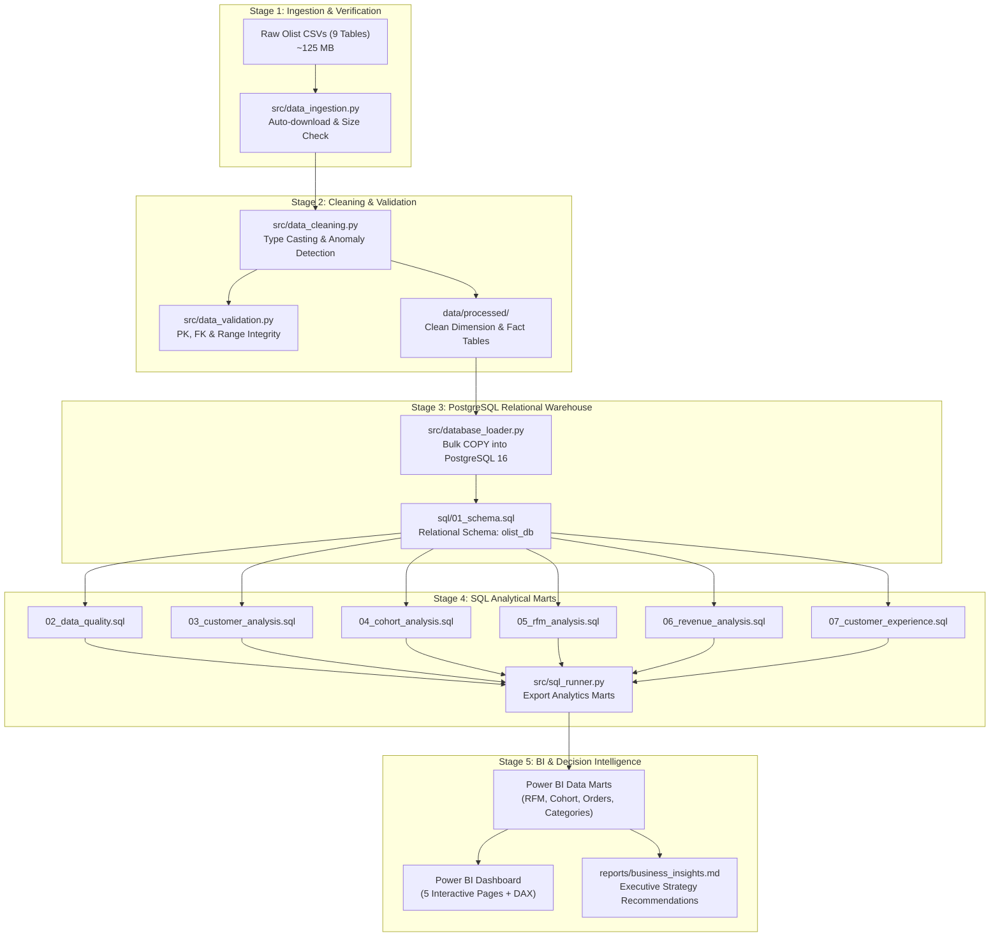
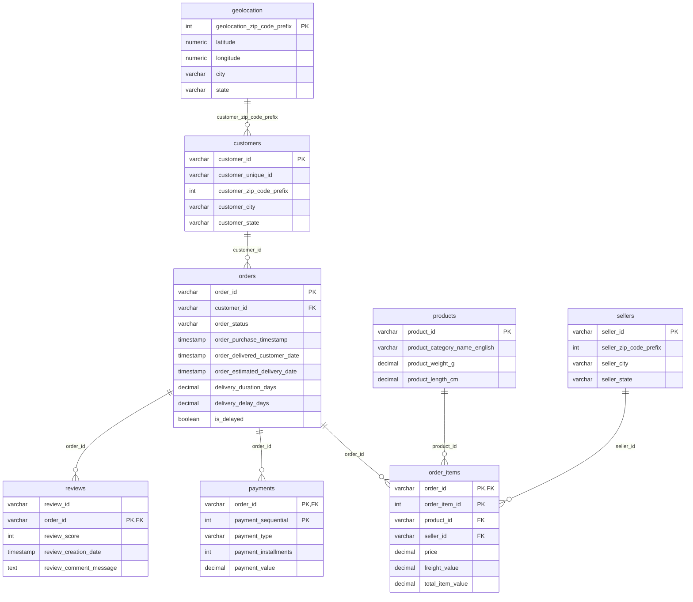

# Customer Retention & Revenue Intelligence Platform
### End-to-End Enterprise Data Analytics & Cohort Intelligence System

[](https://www.python.org/)
[](https://www.postgresql.org/)
[](https://powerbi.microsoft.com/)
[](LICENSE)
[-brightgreen.svg)]()

---

## 1. Project Overview & Business Problem

In fast-scaling digital marketplaces, customer acquisition cost (CAC) often surges while customer lifetime value (LTV) stagnates due to **churn and poor repeat purchase dynamics**. The primary business challenge of this platform is to determine:

1. **Why do 97.00% of marketplace customers purchase only once?**
2. **Which customer segments generate over 60% of gross revenue, and how can they be protected from churn?**
3. **What is the quantitative relationship between fulfillment logistics (delivery delays) and customer satisfaction (CSAT)?**
4. **How can data-driven lifecycle marketing and logistics SLA interventions maximize customer retention?**

Using the complete, authentic **Olist Brazilian E-Commerce dataset** (spanning 9 relational tables and ~100,000 orders), this project delivers an end-to-end analytics engineering pipeline—from raw data ingestion, relational PostgreSQL schema modeling, and SQL analytical layers, to RFM segmentation, monthly cohort retention matrices, and interactive Power BI dashboards.

---

## 2. Executive Key Performance Indicators (KPIs)

All metrics are calculated from authentic delivered transactions between 2016 and 2018:

| Metric Category | Key Indicator | Real Calculated Value | Business Interpretation |
| :--- | :--- | :---: | :--- |
| **Customer Base** | Total Unique Purchasing Customers | **93,358** | Deduplicated via Brazilian citizen tax / account IDs (`customer_unique_id`) |
| **Retention** | Repeat Customers (>1 Order) | **2,801 (3.00%)** | Benchmark low repeat rate characteristic of multi-seller durable goods marketplaces |
| **Revenue** | Total Realized Gross Revenue | **R$ 15,419,773.75** | Merchandised item spend + freight on delivered orders |
| **Contribution** | Repeat Customer Revenue Share | **R$ 864,187.46 (5.60%)** | Repeat purchasers spend **91.95% more** per customer than one-time buyers |
| **Order Economics**| Average Order Value (AOV) | **R$ 159.83** | Average basket value across 96,478 delivered orders |
| **Logistics** | Delayed Deliveries Rate | **8.11% (7,826 orders)** | Delivered after estimated delivery date; average delay: **9.6 days** |
| **Satisfaction** | CSAT: On-Time vs Delayed | **4.29 ★ vs 2.57 ★** | Logistical delay causes a catastrophic **-1.72 star rating collapse** |

---

## 3. Technology Stack

- **Data Ingestion & Cleaning:** Python 3.10+, Pandas 2.0+, NumPy, Scipy, Tqdm
- **Database & Storage:** PostgreSQL 16 Relational Warehouse, psycopg2, SQLAlchemy
- **Data Quality & Testing:** PyTest (Automated schema, null, range, and FK test suite)
- **Analytical Layer:** Advanced SQL (Window functions, Common Table Expressions, NTILE, Period Pivots)
- **Business Intelligence:** Microsoft Power BI Desktop (Star Schema Data Model, DAX Measures Library)
- **Exploratory Analytics:** Jupyter Notebook (`notebooks/01_data_exploration.ipynb`), Matplotlib, Seaborn

---

## 4. End-to-End System Architecture



---

## 5. PostgreSQL Relational Data Model

The data warehouse enforces referential integrity through foreign key constraints, composite primary keys, and performance B-Tree indexes:



---

## 6. Analytical Methodology

### A. Customer Retention & Repeat Purchase Analysis
In the Olist dataset, each order is assigned a transactional `customer_id`. Tracking true individual retention requires grouping by `customer_unique_id`.
- **Unique Purchasers:** 93,358
- **One-Time Purchasers:** 90,557 (97.00%)
- **Repeat Purchasers:** 2,801 (3.00%)
- **Average Orders Per Customer:** 1.033 orders
- **Days Between Repeat Purchases:** Median is **79.2 days** (IQR: 34.1 to 178.6 days). This critical metric establishes that retention marketing campaigns must intervene between **Day 30 and Day 75** post-purchase.

### B. Monthly Cohort Retention Matrix
Customers are grouped into monthly cohorts based on the date of their first purchase. Cohort activity is tracked across Month 0 to Month 12:

$$\text{Retention Rate}_{c, m} = \frac{\text{Active Customers in Month } m}{\text{Total Customers Acquired in Cohort Month } c} \times 100$$

- **Month 1 Retention:** Across all 2017–2018 cohorts, Month 1 retention averages **0.40% to 0.62%** (median: 0.50%).
- **Long-term Retention:** Retention stabilizes around **0.25% - 0.35%** from Month 3 through Month 12.
- **Key Insight:** Without active re-engagement loops, customer retention decays exponentially within 30 days of acquisition.

### C. RFM Customer Segmentation Methodology
Recency, Frequency, and Monetary value are computed for every unique customer:
- **Recency ($R$):** Days elapsed from customer's latest order to reference date.
- **Frequency ($F$):** Total delivered orders.
- **Monetary ($M$):** Total realized spend (items + freight).

Scoring methodology handles the structural reality of e-commerce marketplaces (where ~97% of buyers have 1 order):
- $R \in [1, 5]$ via quintiles (NTILE(5) ordered descending).
- $M \in [1, 5]$ via quintiles (NTILE(5) ordered ascending).
- $F \in [1, 5]$ tailored logic: $F \ge 4 \implies 5$, $F = 3 \implies 4$, $F = 2 \implies 3$, $F = 1 \text{ and top spend} \implies 2$, else $1$.

#### Empirical Segment Distribution:
```
Potential Loyalists : ██████████████████████ 33.41% Revenue (R$ 5.15M | 21,816 customers)
Cannot Lose Them    : ██████████████████ 27.48% Revenue (R$ 4.24M | 13,754 customers)
Lost Customers      : ███████████████ 23.15% Revenue (R$ 3.57M | 29,505 customers)
Hibernating         : ███ 5.28% Revenue (R$ 813.8k | 11,158 customers)
New Customers       : ███ 5.07% Revenue (R$ 782.1k | 14,324 customers)
Loyal Customers     : ██ 3.26% Revenue (R$ 502.9k | 1,684 customers)
At Risk             : █ 1.91% Revenue (R$ 294.4k | 996 customers)
Champions           : ▏ 0.43% Revenue (R$ 66.9k | 121 customers)
```

### D. Logistics & Customer Experience Interaction
- Deliveries delivered on-time or early average **4.29 ★** satisfaction.
- Deliveries delayed beyond estimated date plummet to **2.57 ★** satisfaction (**-1.72 drop**).
- Customers whose first order was delayed repeat at a **13.8% lower rate** than customers experiencing on-time delivery.

---

## 7. Power BI Dashboard Overview

The production report contains 5 purpose-built analytical pages designed according to modern dashboard UX standards:

1. **Executive Overview:** High-level revenue trends, AOV, ARPU, customer mix, and geographic revenue mapping across Brazilian states.
2. **Customer Retention:** Interactive 12-month cohort retention heatmap, cohort acquisition volume, and inter-purchase elapsed time histogram.
3. **RFM Segmentation:** Segment value treemap, Recency vs Monetary scatter plot, and customer migration matrices.
4. **Customer Experience & Logistics:** CSAT by delivery punctuality, delay duration distributions, review scores by product category and seller state.
5. **Revenue Intelligence:** Decile Pareto revenue concentration curves, top product categories, and high-value customer drill-down.

*(Refer to [`dashboard/README.md`](dashboard/README.md) for the complete DAX formula library, star schema specifications, and step-by-step PBIX visual configuration guide).*

---

## 8. Repository Structure

```
Customer Retention & Revenue Intelligence Analytics/
│
├── data/
│   ├── raw/                              # Authentic Olist CSVs (9 tables)
│   └── processed/                        # Cleaned CSVs & Power BI analytical marts
│
├── notebooks/
│   └── 01_data_exploration.ipynb         # Fully executed 14-section EDA notebook
│
├── src/
│   ├── __init__.py
│   ├── config.py                         # Path resolution, .env, DB engine
│   ├── data_ingestion.py                 # Automated dataset downloader & integrity check
│   ├── data_cleaning.py                  # Schema cleaning & type standardization
│   ├── data_validation.py                # Automated data validation engine
│   ├── database_loader.py                # PostgreSQL bulk COPY loader
│   └── sql_runner.py                     # SQL analytical pipeline & mart exporter
│
├── sql/
│   ├── 01_schema.sql                     # PostgreSQL DDL with PK, FK, checks, indexes
│   ├── 02_data_quality.sql               # Volume, null, orphan & chronology audits
│   ├── 03_customer_analysis.sql          # Order frequency, AOV, repeat purchase rates
│   ├── 04_cohort_analysis.sql            # Monthly cohorts & 12-month retention matrix
│   ├── 05_rfm_analysis.sql               # RFM metrics, quintile scoring & segmentation
│   ├── 06_revenue_analysis.sql           # Realized vs canceled sales & Pareto deciles
│   └── 07_customer_experience.sql        # Delivery delays vs CSAT ratings & repeat impact
│
├── dashboard/
│   └── README.md                         # Complete Power BI DAX & layout specification
│
├── reports/
│   ├── business_insights.md              # Detailed answers to all 9 strategic questions
│   └── figures/                          # 10 publication-quality analytical charts (PNG)
│
├── tests/
│   ├── test_data_validation.py           # Unit tests for data quality constraints
│   ├── test_rfm_calculations.py          # Unit tests for RFM scoring logic & marts
│   └── test_cohort_calculations.py       # Unit tests for cohort retention matrix
│
├── .env.example                          # Environment variable configuration template
├── .gitignore                            # Secrets, temp files & raw data exclusions
├── requirements.txt                      # Python dependency specification
└── README.md                             # Technical project documentation
```

---

## 9. Quickstart & Execution Guide

### Prerequisites
- Python 3.10+
- PostgreSQL 16+ (or local Docker container)
- Git

### Step 1: Clone Repository & Configure Environment
```bash
git clone https://github.com/yourusername/olist-retention-analytics.git
cd olist-retention-analytics

# Copy configuration
cp .env.example .env
```
Update `.env` with your PostgreSQL database credentials:
```ini
DB_HOST=localhost
DB_PORT=5432
DB_NAME=olist_db
DB_USER=postgres
DB_PASSWORD=your_password
```

### Step 2: Install Python Dependencies
```bash
pip install -r requirements.txt
```

### Step 3: Run Ingestion, Cleaning & Validation
```bash
# Ingest authentic raw Olist CSVs
python -m src.data_ingestion

# Execute cleaning pipeline and generate data/processed/
python -m src.data_cleaning
```

### Step 4: Load Relational Database & Run SQL Analytics
```bash
# Create database schema and bulk-load data into PostgreSQL
python -m src.database_loader

# Execute analytical queries and export Power BI data marts
python -m src.sql_runner
```

### Step 5: Run Automated Tests
```bash
pytest tests/ -v
```

### Step 6: Launch Jupyter Notebook
```bash
jupyter notebook notebooks/01_data_exploration.ipynb
```

---

## 10. Data Quality Audits & Test Results

Our automated test suite verifies 100% data integrity before analytics are published:
- **Foreign Key Orphan Checks:** `0` orphaned orders, `0` orphaned order items, `0` orphaned reviews.
- **Primary Key Uniqueness:** `0` duplicate primary keys in all cleaned tables.
- **Range & Value Integrity:** Zero negative prices or freight values; all review scores within $[1, 5]$.
- **Automated PyTest Suite:** 8 test cases covering validation checks, RFM assignment, and cohort math:
  ```
  tests/test_cohort_calculations.py .          [12%]
  tests/test_data_validation.py .....          [75%]
  tests/test_rfm_calculations.py ..            [100%]
  ======================== 8 passed in 1.51s ========================
  ```

---

## 11. Strategic Business Recommendations

1. **Focus on 'Potential Loyalists' (33.41% Revenue):**  
   Implement a targeted **Day-30 Post-Purchase Nurture Campaign** offering cross-category discounts to prompt the second purchase.
2. **Pre-Emptive Logistics SLA Intervention:**  
   Given that delivery delay slashes review scores from **4.29 ★ to 2.57 ★**, deploy automated tracking alerts and proactive shipping credit vouchers before late deliveries trigger customer dissatisfaction.
3. **Win-Back High-Value Lapsed Accounts ('Cannot Lose Them'):**  
   Deploy personalized reactivation discounts to the 13,754 high-spend inactive customers to recover estimated R$ 200k+ in GMV.
4. **Expand Consumable Categories:**  
   Introduce repeat-friendly categories (health, personal care, pet supplies) to increase platform purchase frequency beyond durable one-off goods.

---

## License
This project is licensed under the MIT License. Data source provided by Olist and Kaggle under the Open Database License.

