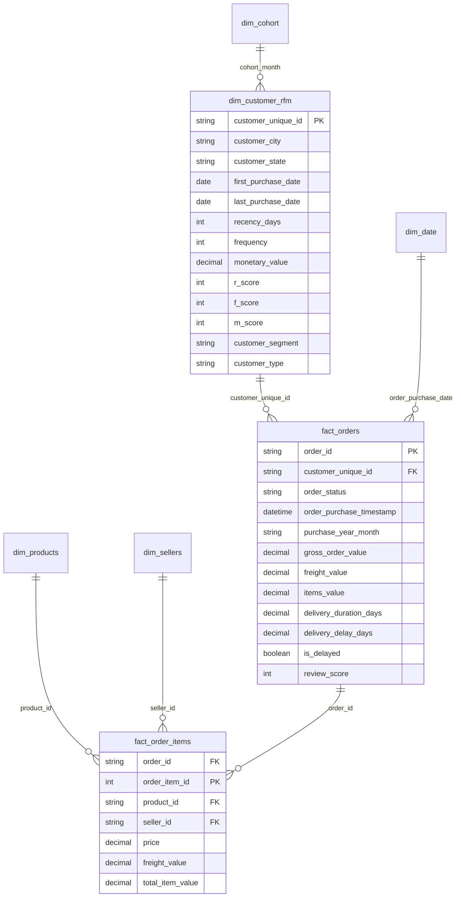

# Power BI Dashboard Specification & Architecture Guide
## Customer Retention & Revenue Intelligence Platform

This guide provides the complete production specification, data model architecture, DAX measure library, visual layout blueprint, and connection instructions for building the interactive **Customer Retention & Revenue Intelligence** Power BI report (`.pbix`).

---

## 1. Architecture & Star Schema Data Model

The Power BI data model is structured around a Star Schema optimized for high-performance analytical slicing and cross-filtering.



### Table Relationships & Cardinality
| From Table | Column | To Table | Column | Cardinality | Cross Filter |
| :--- | :--- | :--- | :--- | :--- | :--- |
| `dim_customer_rfm` | `customer_unique_id` | `fact_orders` | `customer_unique_id` | 1-to-Many (`1:*`) | Single |
| `fact_orders` | `order_id` | `fact_order_items` | `order_id` | 1-to-Many (`1:*`) | Both |
| `dim_products` | `product_id` | `fact_order_items` | `product_id` | 1-to-Many (`1:*`) | Single |
| `dim_sellers` | `seller_id` | `fact_order_items` | `seller_id` | 1-to-Many (`1:*`) | Single |
| `dim_cohort` | `cohort_month` | `dim_customer_rfm` | `cohort_month` | 1-to-Many (`1:*`) | Single |

---

## 2. Complete DAX Measures Library

Create a dedicated measure table `_Measures` and organize DAX formulas into display folders.

### Domain 1: Executive Overview & Revenue KPIs
```dax
-- Total Gross Revenue (Realized Delivered Orders)
Total Gross Revenue = 
CALCULATE(
    SUM(fact_orders[gross_order_value]),
    fact_orders[order_status] = "delivered"
)

-- Total Merchandise Spend
Total Merchandise Revenue = 
CALCULATE(
    SUM(fact_orders[items_value]),
    fact_orders[order_status] = "delivered"
)

-- Total Freight Collected
Total Freight Revenue = 
CALCULATE(
    SUM(fact_orders[freight_value]),
    fact_orders[order_status] = "delivered"
)

-- Total Delivered Orders
Total Delivered Orders = 
CALCULATE(
    DISTINCTCOUNT(fact_orders[order_id]),
    fact_orders[order_status] = "delivered"
)

-- Total Unique Purchasing Customers
Total Unique Customers = 
DISTINCTCOUNT(dim_customer_rfm[customer_unique_id])

-- Average Order Value (AOV)
Average Order Value = 
DIVIDE([Total Gross Revenue], [Total Delivered Orders], 0)

-- Average Revenue Per User (ARPU / LTV)
Average Customer Revenue = 
DIVIDE([Total Gross Revenue], [Total Unique Customers], 0)
```

### Domain 2: Customer Retention & Repeat Purchase Measures
```dax
-- Count of Repeat Purchasing Customers (>1 Delivered Order)
Repeat Customers = 
CALCULATE(
    DISTINCTCOUNT(dim_customer_rfm[customer_unique_id]),
    dim_customer_rfm[customer_type] = "Repeat Customer"
)

-- Count of One-Time Customers
One-Time Customers = 
CALCULATE(
    DISTINCTCOUNT(dim_customer_rfm[customer_unique_id]),
    dim_customer_rfm[customer_type] = "One-Time Customer"
)

-- Repeat Purchase Rate (%)
Repeat Purchase Rate % = 
DIVIDE([Repeat Customers], [Total Unique Customers], 0) * 100

-- Revenue Generated by Repeat Customers
Repeat Customer Revenue = 
CALCULATE(
    [Total Gross Revenue],
    dim_customer_rfm[customer_type] = "Repeat Customer"
)

-- Repeat Customer Revenue Contribution (%)
Repeat Revenue Share % = 
DIVIDE([Repeat Customer Revenue], [Total Gross Revenue], 0) * 100

-- Monthly Cohort Retention Rate (%)
Cohort Retention Rate % = 
VAR ActiveCust = DISTINCTCOUNT(fact_orders[customer_unique_id])
VAR CohortSize = SELECTEDVALUE(dim_cohort[cohort_size])
RETURN
    DIVIDE(ActiveCust, CohortSize, 0) * 100
```

### Domain 3: Customer Experience & Logistics KPIs
```dax
-- Average Review Score (1 to 5 Stars)
Average Review Score = 
CALCULATE(
    AVERAGE(fact_orders[review_score]),
    NOT(ISBLANK(fact_orders[review_score]))
)

-- Percentage of 5-Star Reviews
Positive Reviews % = 
VAR HighScore = CALCULATE(COUNTROWS(fact_orders), fact_orders[review_score] >= 4)
VAR TotalReviews = CALCULATE(COUNTROWS(fact_orders), NOT(ISBLANK(fact_orders[review_score])))
RETURN
    DIVIDE(HighScore, TotalReviews, 0) * 100

-- Delayed Orders Count
Delayed Orders Count = 
CALCULATE(
    COUNTROWS(fact_orders),
    fact_orders[order_status] = "delivered",
    fact_orders[is_delayed] = TRUE()
)

-- Late Delivery Rate (%)
Late Delivery Rate % = 
DIVIDE([Delayed Orders Count], [Total Delivered Orders], 0) * 100

-- On-Time Delivery Rate (%)
On-Time Delivery Rate % = 
100 - [Late Delivery Rate %]

-- Average Delivery Duration (Days)
Average Delivery Duration Days = 
CALCULATE(
    AVERAGE(fact_orders[delivery_duration_days]),
    fact_orders[order_status] = "delivered"
)

-- Average Delay Duration (Days for Delayed Orders)
Average Delay Days = 
CALCULATE(
    AVERAGE(fact_orders[delivery_delay_days]),
    fact_orders[order_status] = "delivered",
    fact_orders[is_delayed] = TRUE()
)
```

---

## 3. Page-by-Page Visual Design Blueprint

### Design Palette & Standards
- **Background:** `#F8FAFC` (Clean slate white)
- **Cards/Containers:** `#FFFFFF` with 1px border `#E2E8F0` and subtle shadow
- **Primary Navy:** `#0F172A`
- **Accent Teal/Cyan:** `#0EA5E9`
- **Success Green:** `#10B981`
- **Warning Amber:** `#F59E0B`
- **Danger Red:** `#EF4444`

---

### Page 1: Executive Overview
*Audience: C-Suite, VP of E-Commerce, General Managers*

1. **Header & Global Slicers (Top Banner):**
   - Title: `Customer Retention & Revenue Intelligence Platform`
   - Slicers: Date Range (`order_purchase_timestamp`), Customer State (`customer_state`), Order Status.
2. **KPI Scorecard (Top Row - 5 Cards):**
   - Card 1: `Total Gross Revenue` (R$ 15.42M)
   - Card 2: `Total Delivered Orders` (96,478)
   - Card 3: `Unique Customers` (93,358)
   - Card 4: `Repeat Purchase Rate` (3.00%)
   - Card 5: `Average Order Value (AOV)` (R$ 159.83)
3. **Charts (Middle & Bottom Rows):**
   - **Visual 1 (Area Chart):** Monthly Revenue Trend (`purchase_year_month` vs `Total Gross Revenue`).
   - **Visual 2 (Donut Chart):** Customer Mix (`Repeat Customer` vs `One-Time Customer` by `Total Unique Customers` & `Revenue`).
   - **Visual 3 (Horizontal Bar Chart):** Revenue Contribution by Customer Segment.
   - **Visual 4 (Filled Map / Shape Map):** Revenue by Brazilian State (`customer_state`).

---

### Page 2: Customer Retention Analysis
*Audience: Retention Marketing, CRM Leads, Growth Teams*

1. **KPI Scorecard:**
   - Card 1: `Repeat Purchase Rate` (3.00%)
   - Card 2: `Repeat Customers` (2,801)
   - Card 3: `Repeat Revenue Share` (5.60%)
   - Card 4: `Avg Days Between Orders` (79.2 days)
2. **Cohort Retention Heatmap (Matrix Visual):**
   - **Rows:** `cohort_label` (2017-01 to 2018-08)
   - **Columns:** `cohort_index` (Month 0 to Month 12)
   - **Values:** `Cohort Retention Rate %`
   - **Conditional Formatting:** Background color gradient from light blue (0%) to deep navy (100%).
3. **Monthly Cohort Acquisition & Size (Clustered Column Chart):**
   - X-Axis: `cohort_month`
   - Y-Axis: `Cohort Size`
4. **Inter-Purchase Time Distribution (Column / Histogram):**
   - Days elapsed between 1st and 2nd purchase buckets (0-30d, 31-60d, 61-90d, 91-180d, 180d+).

---

### Page 3: RFM Customer Segmentation
*Audience: Lifecycle Marketing, Campaign Strategy, Email/CRM Specialists*

1. **Segment Overview Cards (4 Cards):**
   - Card 1: `Potential Loyalists` Count & Revenue (21,816 / R$ 5.15M)
   - Card 2: `Cannot Lose Them` Count & Revenue (13,754 / R$ 4.24M)
   - Card 3: `Lost Customers` Count & Revenue (29,505 / R$ 3.57M)
   - Card 4: `Champions` Count & Revenue (121 / R$ 66.8k)
2. **RFM Treemap Visual:**
   - Category: `customer_segment`
   - Size: `Total Gross Revenue`
   - Color Saturation: `Customer Count`
3. **Recency vs Monetary Scatter Plot:**
   - X-Axis: `Average Recency Days` (Inverted)
   - Y-Axis: `Average Monetary Value`
   - Legend / Details: `customer_segment`
   - Bubble Size: `Customer Count`
4. **Segment Profile Matrix (Table Visual):**
   - Columns: `Segment`, `Customer Count`, `Customer %`, `Total Revenue`, `Revenue %`, `Avg Recency (Days)`, `Avg Frequency`, `Avg Spend (BRL)`.

---

### Page 4: Purchase Behaviour & Product Performance
*Audience: Commercial Directors, Merchandising, Supply Chain, Logistics Leads*

1. **Product Category Revenue Analysis (Horizontal Bar Chart):**
   - X-Axis: `Gross Revenue (BRL)`
   - Y-Axis: `product_category_name_english` (Top 15: Bed Bath Table, Health Beauty, Computers Accessories, Sports Leisure, Furniture Decor).
   - Tooltips: `Units Sold`, `Avg Item Price`, `Avg Review Score`.
2. **Monthly Purchase Trends (Line Chart):**
   - X-Axis: `purchase_year_month` (2016-09 to 2018-08)
   - Y-Axis: `Total Orders` and `Total Gross Revenue` (Dual Axis).
3. **Payment Method Distribution (Donut Chart & Installments Bar):**
   - Donut Chart: Revenue share by payment type (`credit_card` 74.0%, `boleto` 19.3%, `voucher` 3.8%, `debit_card` 1.5%, `unknown` 0.0%).
   - Bar Chart: Average payment installments by payment method (Credit card average: 3.5 installments).
4. **Order Basket Value Distribution (Histogram / Bucketed Column Chart):**
   - Spend tiers: `< R$ 50`, `R$ 50 - 100`, `R$ 100 - 200`, `R$ 200 - 500`, `> R$ 500`.
5. **Geographic Customer & Revenue Analysis (Filled / Bubble Map & Bar Chart):**
   - Map: Customer concentration across Brazilian states (`SP`, `RJ`, `MG`, `RS`, `PR`).
   - Bar Chart: Total revenue and average order value by customer state.
6. **Logistics & CSAT Sensitivity Panel:**
   - On-time vs delayed order count and review rating comparison (4.29 ★ on-time vs 2.57 ★ delayed).
   - Delivery delay distribution and average duration by state.

---

## 4. How to Connect Data in Power BI Desktop

### Option A: Direct PostgreSQL Connection (Recommended for Live Database)
1. Open Power BI Desktop.
2. Select **Get Data** -> **PostgreSQL Database**.
3. Server: `localhost:5432`, Database: `olist_db`.
4. Data Connectivity mode: Select **Import** (or DirectQuery).
5. Enter credentials: User `postgres`, Password `postgres` (or as configured in `.env`).
6. Select tables:
   - `customers`
   - `orders`
   - `order_items`
   - `payments`
   - `reviews`
   - `products`
   - `sellers`
   - `geolocation`
7. Click **Load**.

### Option B: High-Performance Pre-Built Analytical Data Marts (Instant Setup)
If connecting without a local PostgreSQL service running:
1. Open Power BI Desktop.
2. Select **Get Data** -> **Text/CSV**.
3. Load the pre-aggregated CSVs generated by our pipeline in `data/processed/`:
   - `mart_customer_rfm.csv` (Customer master with RFM scores and segments)
   - `mart_cohort_retention.csv` (Monthly retention matrix data)
   - `mart_orders_analytics.csv` (Order master with logistics, reviews, and spend)
   - `mart_category_performance.csv` (Category-level revenue and satisfaction metrics)
4. Apply the DAX measures provided in Section 2 above.

