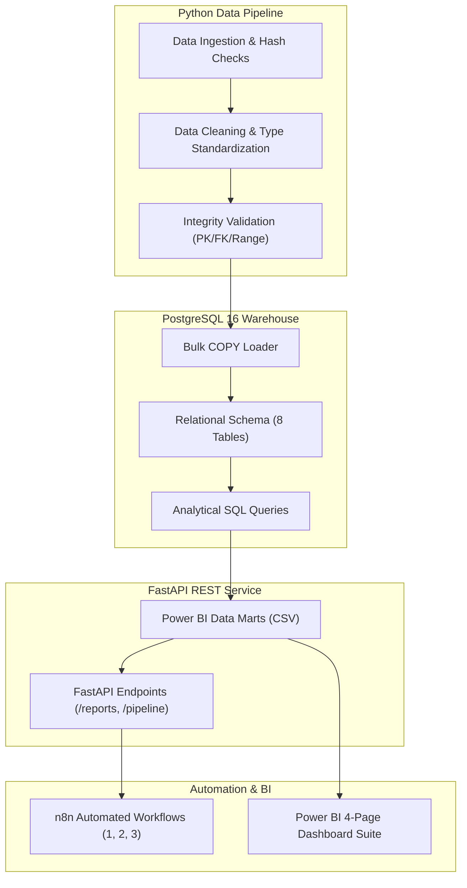

# Functional Requirements Document (FRD)
## Customer Retention & Purchase Behaviour Intelligence Platform

**Document Version:** 1.0.0  
**Status:** Approved & Verified  
**Target Systems:** Python 3.10+, PostgreSQL 16, FastAPI, n8n, Power BI Desktop  

---

## 1. Functional System Architecture

---

## 2. Functional Requirements by Module

### FR 1: Data Ingestion & Quality Engine (`src/data_ingestion.py`, `src/data_validation.py`)
- **FR 1.1:** System shall ingest all 9 raw CSV files and verify minimum file sizes.
- **FR 1.2:** System shall validate non-empty tables and assert zero primary key duplicate records.
- **FR 1.3:** System shall verify referential integrity across 6 foreign key relationships with zero tolerated orphaned records.
- **FR 1.4:** System shall validate numeric boundaries ($price \ge 0$, $freight \ge 0$, $payment \ge 0$, $1 \le review\_score \le 5$).

### FR 2: Data Cleaning & Feature Engineering (`src/data_cleaning.py`)
- **FR 2.1:** System shall convert all 5 order timestamps (`order_purchase_timestamp`, `order_approved_at`, `order_delivered_carrier_date`, `order_delivered_customer_date`, `order_estimated_delivery_date`) into UTC datetime.
- **FR 2.2:** System shall calculate logistics metrics:
  $$\text{delivery\_duration\_days} = \frac{\text{order\_delivered\_customer\_date} - \text{order\_purchase\_timestamp}}{86400}$$
  $$\text{delivery\_delay\_days} = \frac{\text{order\_delivered\_customer\_date} - \text{order\_estimated\_delivery\_date}}{86400}$$
  $$\text{is\_delayed} = (\text{order\_delivered\_customer\_date} > \text{order\_estimated\_delivery\_date})$$
- **FR 2.3:** System shall deduplicate customer reviews to exactly 1 record per order, keeping the latest review by `review_answer_timestamp`.
- **FR 2.4:** System shall translate product categories to English and aggregate raw GPS coordinates to unique zip code prefixes.

### FR 3: Database Storage & Analytical Queries (`sql/`)
- **FR 3.1:** PostgreSQL database `olist_db` shall maintain relational constraints and B-Tree indexes.
- **FR 3.2:** System shall group customers by first qualifying delivered purchase month into acquisition cohorts ($M_0 \dots M_{12}$).
- **FR 3.3:** System shall compute RFM scores ($R \in [1,5]$, $F \in [1,5]$, $M \in [1,5]$) and assign customers into 8 predefined segments:
  - *Champions* ($R \ge 4, F \ge 4$)
  - *Loyal Customers* ($R \ge 3, F \ge 3$)
  - *Potential Loyalists* ($R \ge 4, F \in [1,2], M \ge 3$)
  - *New Customers* ($R \ge 4, F = 1$)
  - *At Risk* ($R \le 2, F \ge 3$)
  - *Cannot Lose Them* ($R \le 2, M \ge 4$)
  - *Hibernating* ($R = 2, F \le 2$)
  - *Lost Customers* (Others)

### FR 4: FastAPI REST Integration (`src/api.py`)
- **FR 4.1:** System shall expose `GET /health` probing database connectivity.
- **FR 4.2:** System shall expose `POST /pipeline/run` protected by `X-API-Key` header, dispatching background pipeline runs without blocking.
- **FR 4.3:** System shall expose `GET /reports/summary`, `GET /reports/retention`, `GET /reports/rfm`, and `GET /reports/categories`.
- **FR 4.4:** System shall provide interactive OpenAPI/Swagger documentation at `/docs`.

### FR 5: n8n Workflow Automation (`n8n/`)
- **FR 5.1:** Workflow 1 shall automate weekly pipeline execution and report success/failure.
- **FR 5.2:** Workflow 2 shall poll `/reports/summary`, compare repeat rates, delay rates, and delayed CSAT against governance thresholds, and generate critical alerts.
- **FR 5.3:** Workflow 3 shall poll `/reports/rfm`, format a responsive HTML table of all 8 segments, and prepare email briefings for leadership.

### FR 6: Power BI Dashboard Integration (`dashboard/`)
- **FR 6.1:** System shall provide pre-aggregated data marts in `data/processed/` conforming to a Star Schema.
- **FR 6.2:** System shall provide 20+ DAX measure formulas across 4 dedicated dashboard pages:
  - Page 1: Executive Overview
  - Page 2: Customer Retention
  - Page 3: RFM Segmentation
  - Page 4: Purchase Behaviour
