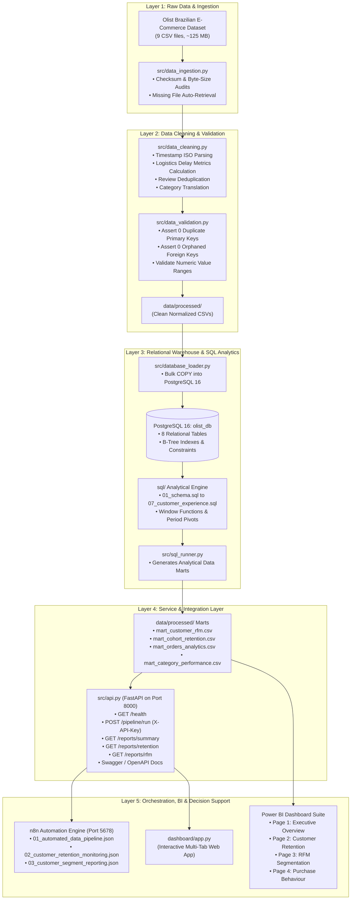

# System Architecture & Technical Design Specification
## Customer Retention & Purchase Behaviour Intelligence Platform

---

## 1. System Architecture Overview

The system is architected as a modular, five-layer analytics engineering pipeline:

---

## 2. Technology Selection Rationale

| Component | Selected Technology | Alternative Considered | Selection Rationale |
| :--- | :--- | :--- | :--- |
| **Data Cleaning** | **Python (Pandas & NumPy)** | R / OpenRefine | Universal analytics adoption, high-performance vectorized operations, seamless integration with database drivers (`psycopg2`). |
| **Storage Engine** | **PostgreSQL 16** | SQLite / MySQL | ACID compliance, advanced SQL window functions (`NTILE`, `LAG`, `PERCENTILE_CONT`), high-speed `COPY` bulk ingestion, relational constraint enforcement. |
| **API Framework** | **FastAPI + Uvicorn** | Flask / Django | Asynchronous background task handling (`BackgroundTasks`), automatic OpenAPI/Swagger documentation, high concurrency, strict Pydantic type validation. |
| **Workflow Automation**| **n8n (Self-Hosted)** | Apache Airflow / Zapier | Visual workflow designer, low-code HTTP API node integrations, scheduled execution, zero cloud subscription fees, runs locally via `npx n8n`. |
| **Business Intelligence**| **Power BI Desktop** | Tableau / Looker | Industry-standard DAX analytical engine, high compression in-memory VertiPaq tabular model, Star Schema optimization, seamless CSV/SQL connectors. |

---

## 3. Data Flow & Security Architecture

1. **Environment Configuration:**
   - Database credentials, API security tokens, and file paths are stored in `.env` and excluded from git tracking via `.gitignore`.
   - `.env.example` provides a sanitized configuration template.
2. **API Key Authentication:**
   - Sensitive endpoints (`POST /pipeline/run`) require an `X-API-Key` HTTP header. Missing or incorrect keys return `403 Forbidden`.
3. **Non-Blocking Asynchronous Operations:**
   - When n8n or an external caller triggers `/pipeline/run`, FastAPI immediately returns `200 OK (Status: Initiated)` and offloads execution to an isolated background thread, preventing HTTP request timeouts on long-running batch jobs.

---

## 4. Resilience & Error Handling

- **Idempotent Ingestion:** The database loader checks if `olist_db` exists; table DDL scripts use `DROP TABLE IF EXISTS ... CASCADE` and recreate clean tables without leaving orphaned state.
- **Fail-Safe Data Marts:** If PostgreSQL is temporarily offline during scheduled reports, the API gracefully serves cached, validated analytical data marts from `data/processed/`.
- **Integrity Gates:** Automated PyTest test suites halt downstream deployments if primary key uniqueness or foreign key constraints fail.
