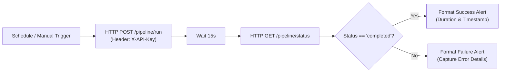
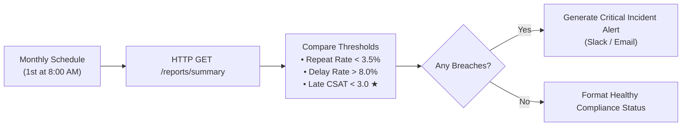
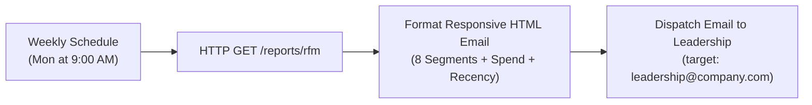

# n8n Workflow Automation Architecture & Setup Guide
## Customer Retention & Purchase Behaviour Intelligence

This directory contains three production-grade, importable **n8n workflow JSON files** that automate data engineering, retention threshold governance, and executive reporting by integrating directly with our FastAPI layer.

---

## 1. Workflows Overview

| Workflow | File | Trigger | Core Responsibility |
| :--- | :--- | :--- | :--- |
| **Workflow 1: Automated Data Pipeline** | [`01_automated_data_pipeline.json`](01_automated_data_pipeline.json) | Manual or Weekly Schedule (Sun 2AM) | Dispatches pipeline execution via `POST /pipeline/run`, monitors completion status, and alerts on success/failure. |
| **Workflow 2: Retention SLA Monitoring** | [`02_customer_retention_monitoring.json`](02_customer_retention_monitoring.json) | Monthly Schedule (1st at 8AM) | Audits retention rate (3.5% threshold), late deliveries (>8.0%), and CSAT degradation (<3.0★) to trigger operational alerts. |
| **Workflow 3: Customer Segment Reporting** | [`03_customer_segment_reporting.json`](03_customer_segment_reporting.json) | Weekly Schedule (Mon 9AM) | Pulls live RFM segmentation data, constructs a responsive executive HTML table, and formats email briefings for leadership. |

---

## 2. Workflow Architectures

### Workflow 1: Automated Data Pipeline Orchestrator


### Workflow 2: Customer Retention SLA & Threshold Monitoring


### Workflow 3: Customer Segment Executive Reporting


---

## 3. How to Run & Import Workflows in n8n

### Step 1: Start n8n Locally
Because Node.js and npm are installed on your machine, you can launch n8n directly with zero installation using `npx`:

```bash
npx n8n
```
*(Or if you prefer Docker: `docker run -it --rm --name n8n -p 5678:5678 -v ~/.n8n:/home/node/.n8n n8nio/n8n`)*

n8n will start and display:
```
Editor is now accessible via:
http://localhost:5678/
```

### Step 2: Open n8n in Your Browser
Open **`http://localhost:5678/`** and complete the quick 1-minute initial admin setup.

### Step 3: Import the Workflows
1. In the left navigation bar, click on **Workflows**.
2. Click the **Add Workflow** button (or click the `...` menu in the top right).
3. Select **Import from File**.
4. Choose any of the workflow JSON files from this directory:
   - `n8n/01_automated_data_pipeline.json`
   - `n8n/02_customer_retention_monitoring.json`
   - `n8n/03_customer_segment_reporting.json`
5. Click **Save** and toggle the workflow to **Active**.

---

## 4. Environment Variables Configuration

The workflow nodes use dynamic expressions (`$env.FASTAPI_BASE_URL`, `$env.API_KEY`, `$env.REPORT_RECIPIENT_EMAIL`) with smart fallbacks to local defaults. 

If running n8n in production, configure these variables in your n8n environment or `.env`:

```ini
FASTAPI_BASE_URL=http://127.0.0.1:8000
API_KEY=olist_secret_token_2026
REPORT_RECIPIENT_EMAIL=leadership@company.com
```

---

## 5. Testing the Workflows with the Live FastAPI Service

1. Ensure the FastAPI integration server is running:
   ```powershell
   py -m uvicorn src.api:app --host 127.0.0.1 --port 8000
   ```
2. In n8n, open **Workflow 2: Customer Retention Monitoring**.
3. Click **Test Step** or **Execute Workflow**.
4. Watch each node illuminate green as it fetches live data from `http://127.0.0.1:8000/reports/summary`, evaluates the 3 thresholds, and formats the executive incident alert!
